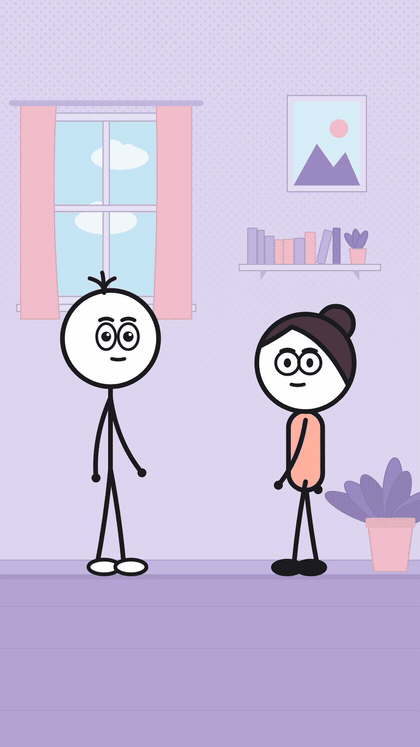
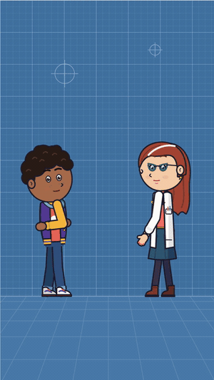
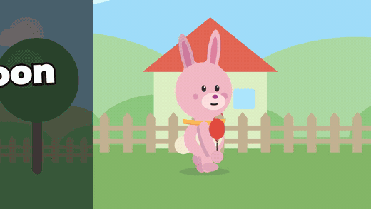

# StickStage

**StickStage is an open-source stick figure video generator: write a premise, get a captioned,
lip-synced 9:16 comedy short** for YouTube Shorts, TikTok or Reels. No account and no API key:
voices, lip sync and rendering all run offline on your own computer, built on Remotion.

[](https://github.com/tamtree-ai/stick-stage/actions/workflows/ci.yml)
[](https://github.com/tamtree-ai/stick-stage/actions/workflows/quickstart.yml)
[](LICENSE)
[](https://nodejs.org)
[](https://codespaces.new/tamtree-ai/stick-stage)

<p align="center">
  
</p>

<p align="center"><i>One of the bundled skits, rendered by <code>pnpm render group-chat</code>.
<a href="docs/media/group-chat.mp4">Watch it with sound</a>.</i></p>

You write the premise and the lines. StickStage handles the rest: timing, listener reactions, shots
and cuts (two-shots, punch-ins, emotion close-ups), subtitles, sound effects, and frame-by-frame
rendering with [Remotion](https://www.remotion.dev). Characters are original, and the sets are
drawn entirely in code.

- **Runs locally.** Voices come from [Kokoro](https://huggingface.co/hexgrad/Kokoro-82M) on your CPU. Rendering never touches the network.
- **Everything is data.** A skit is one JSON file. Characters, sets, props and poses are JSON too, so adding one is a data change, not a rewrite.
- **Three looks.** Stick figures, toon characters, and a shape cast for narrated stories.
- **Works with Claude Code.** Five bundled [skills](skills/) turn "make a video about X" into a finished file.
- **Science shorts.** Myth-flip explainers with figures timed to the words, and claims that need an owner's sign-off.

The manual, written so a new person can follow it and so an engineer can trace one video from a
topic to the posted files: [docs/README.md](docs/README.md).

## Quickstart

No account, no key, no Docker. You need Node 22+ and pnpm. Prefer not to install anything? Open it in [GitHub Codespaces](https://codespaces.new/tamtree-ai/stick-stage) and run the same three commands.

> **Licences before you start.** StickStage renders with [Remotion](https://www.remotion.dev),
> which is free for individuals and companies of up to 3 people. Larger companies need a
> [Remotion company licence](https://www.remotion.dev/license); part-timers and contractors count.
> StickStage's own licence is in [License](#license).

<!-- quickstart -->
```sh
pnpm install
pnpm bootstrap
pnpm demo
```
<!-- /quickstart -->

`pnpm bootstrap` downloads Rhubarb Lip Sync (checked against a pinned SHA-256) and Remotion's
headless Chrome, then prints one line per check. `pnpm demo` renders the example skit, whose
voices are in the repo, to `out/fine.mp4`. It never fails because of Rhubarb: without it, the
mouths are estimated from the words. `pnpm diagnose` shows what this machine has and lacks.

Then make your own:

```sh
pnpm try "my cat ignores me"     # stages a two-person premise for you to write
pnpm try my-cat-ignores-me       # voices it with Kokoro on this computer and renders it
```

Voices come from [Kokoro](https://huggingface.co/hexgrad/Kokoro-82M) (Apache-2.0), run in-process
on the CPU. Its weights download once (~90 MB) to `~/.cache/stickstage/kokoro`. They are flatter
than cloud voices on sarcasm; Tamtree's cloud TTS is the quality path.

### Your own model (optional)

You write the jokes. To have a model draft them, point StickStage at any OpenAI-compatible server
or at Anthropic. `pnpm try` and `pnpm write draft --model` then write the premise, with one repair
when the reply can't be used:

```sh
export LOCAL_LLM_BASE_URL=http://localhost:11434/v1   # Ollama; LM Studio, OpenRouter, OpenAI work too
export LOCAL_LLM_MODEL=qwen3:8b
export LOCAL_LLM_API_KEY=…                             # only if the server wants one
```

Without a model, `pnpm write prompt --brief=<file>` prints the prompt to paste into any chatbot,
and `pnpm write draft --brief=<file> --reply=<file>` turns its reply into a premise. The reply's
shape is [`schemas/writer-reply.schema.json`](schemas/writer-reply.schema.json).

## Gallery

| Comedy skit (stick) | Science short (toon) | Story (shape cast) |
|---|---|---|
|  |  |  |
| `group-chat` | `coin-due` | `lost-balloon` |

The skits above are in [`public/skits/`](public/skits/), so `pnpm render <name>` makes them on your machine.

## Use it from Claude Code

Open the repo in [Claude Code](https://claude.com/claude-code) and ask for what you want. The skills in
[`skills/`](skills/) write the jokes, stage them, render, and package the files:

> make a video about people who never read the terms and conditions

| Skill | Does |
|---|---|
| [`topic-to-video`](skills/topic-to-video/SKILL.md) | A topic to a ~30 s skit, end to end |
| [`skit-director`](skills/skit-director/SKILL.md) | Stages a premise you wrote; never changes a line |
| [`science-short`](skills/science-short/SKILL.md) | A myth-flip science short with sourced claims; never approves them |
| [`toon-character`](skills/toon-character/SKILL.md) | Adds or changes a toon character |
| [`story-episode`](skills/story-episode/SKILL.md) | An idea to a narrated 16:9 story |

## Make a skit

```sh
pnpm new myskit --template=exchange   # stage a premise.json; write the lines, then run again
pnpm voice:tts myskit                 # local voices (Kokoro); voice:say uses macOS say; Tamtree does this in production
pnpm direct myskit                    # validate → prep → compile → self-check → contact sheet → MP4
```

Or step by step:

```sh
pnpm compile myskit    # validate and print the director's choices (beats, cuts and why, SFX)
pnpm check myskit      # self-check: safe areas, overlay collisions, contrast, staging rules
pnpm render myskit     # prep → compile → out/myskit.mp4   (--debug burns in labels)
pnpm batch --all       # post-ready mp4 + srt + txt + json per skit in out/posts/
```

Templates: `exchange`, `interview`, `me-vs-me`, `pov-monologue`, `text-slam`. A full example is
in `public/skits/fine/skit.json`, and the authoring guide is [docs/skits.md](docs/skits.md).

A skit is one JSON file:

```json
{
  "schemaVersion": 1,
  "meta": { "title": "Not being sarcastic" },
  "set": "office-1",
  "cast": [
    { "id": "milo", "character": "milo", "mark": "left" },
    { "id": "june", "character": "june", "mark": "right" }
  ],
  "overlay": { "pov": "POV: your coworker says they're fine" },
  "beats": [
    { "id": "b1", "speaker": "june", "line": "I'm fine. Totally fine.", "expression": "deadpan" },
    { "id": "b2", "speaker": "milo", "line": "Right. Sure.", "pauseBeforeMs": 300,
      "text": [ { "type": "slam", "value": "SURE.", "at": { "word": "Sure" } } ] }
  ]
}
```

## Requirements

- Node 22+, pnpm
- [Rhubarb Lip Sync](https://github.com/DanielSWolf/rhubarb-lip-sync) for mouths: `pnpm bootstrap`
  installs it into `tools/`; or set `RHUBARB_PATH`, or put it on `PATH`. The macOS build is
  Intel-only, so Apple Silicon needs Rosetta (`softwareupdate --install-rosetta`); Linux arm64 has
  no release build (build it from source, or let the mouths be estimated)
- Kokoro (`kokoro-js`, an optional dependency) for local voices; macOS `say` (`pnpm voice:say`) also works
- whisper.cpp (`whisper-cli` + `WHISPER_MODEL`), only for lip-syncing to existing audio (optional)

```sh
pnpm dev            # Remotion Studio
scripts/start.sh    # render service in the background (scripts/stop.sh to stop)
```

Step by step, with the service and troubleshooting: [docs/getting-started.md](docs/getting-started.md).

## Advanced: Tamtree, the render service and cloud voices

StickStage is also a node in [Tamtree](https://www.tamtree.io) workflows. None of this is needed to make videos.

### Render service

`pnpm serve` runs StickStage as an HTTP service for tamtree: `POST /validate` (premise → skit + the
lines to voice), `POST /render` (skit + voice.json + audio → job), `GET /jobs/:id`. `Dockerfile`
builds the Linux image (Chrome Headless Shell + Rhubarb). API: [docs/render-service.md](docs/render-service.md).

### Voices

The engine and the render service never call a TTS or an LLM, and no provider keys live in them.
In production the Tamtree harness writes `public/skits/<id>/voice/<line>.wav` and `voice.json`
(audio plus optional word timings); see [docs/voice-contract.md](docs/voice-contract.md). On your
own machine, the dev scripts fill the same contract: `pnpm voice:tts` (Kokoro in-process, or any
OpenAI-compatible `/audio/speech` at `LOCAL_TTS_BASE_URL`) and `pnpm voice:say` (macOS). `pnpm prep`
then aligns words to the script and runs Rhubarb, cached by content hash. Rendering needs no
network access.

## Layout

| Path | What |
|---|---|
| `src/engine/` | Pure rendering and compiling: rig, face, props, sets, shots, text, director, QA. No `fs`, `process.env` or `registerRoot` |
| `src/node/` | File and tool adapters (ffmpeg, WAV, Rhubarb, whisper.cpp), prep, render backend, post files |
| `src/server/` | The render service (`pnpm serve`): routes, auth, job queue, render pipeline |
| `src/app/` | Remotion root, `Skit` compositions and the labs (`CharacterLab`, `CloseupLab`, `TalkLab`, `SetLab`, `StagingLab`, …) |
| `src/data/` | Characters (+ cast bibles), poses, expressions, sets, SFX manifest, safe areas |
| `scripts/` | CLI entry points behind the `pnpm` commands |
| `public/skits/<id>/` | `skit.json`, `voice.json`, `voice/*.wav`; `generated/` is gitignored |
| `packages/stickstage/` | Library package boundary (`stickstage`, `/schema`, `/remotion`, `/node`); not published |
| `skills/skit-director/` | Claude skill that stages a human-written premise into a valid `skit.json` |

## Development

```sh
pnpm test && pnpm typecheck && pnpm lint                  # before every commit
pnpm sheet <Comp> <from> <to> <step>                      # contact sheet PNG in out/
pnpm render <Comp> out/x.mp4 --frames=a-b                 # render any lab composition
```

Motion is reviewed as video, not stills. Rendering is frame-pure: every visual is a function of
`(frame, props)`, with seeded randomness only. See [AGENTS.md](AGENTS.md) for the core rules and
[DECISIONS.md](DECISIONS.md) for tuned values and design decisions.

## FAQ

**Does StickStage need an API key or an internet connection?**
No. Voices come from Kokoro running on your CPU, and rendering never touches the network. The
first run downloads a few tools once: `pnpm bootstrap` fetches Rhubarb Lip Sync and Remotion's
headless Chrome, and Kokoro's weights (~90 MB) download on first use. A language model is
optional (see [Your own model](#your-own-model-optional)).

**Can AI write the jokes for me?**
Yes, if you want it to. Point `LOCAL_LLM_*` at Ollama, LM Studio, OpenRouter, OpenAI or
Anthropic, or run `pnpm write prompt` and paste the prompt into any chatbot. With Claude Code,
the [`topic-to-video`](skills/topic-to-video/SKILL.md) skill goes from a topic to a finished
video. You can also write every line yourself.

**What does it output?**
A 1080×1920 (9:16) MP4 with burned-in captions. `pnpm batch` adds an `.srt`, a `.txt` and a
`.json` for each skit, ready to post. Narrated stories render at 16:9.

**Can I use the videos commercially?**
StickStage's code is MIT. It renders with Remotion, which is free for individuals and companies
of up to 3 people; larger companies need a
[Remotion company licence](https://www.remotion.dev/license). Kokoro is Apache-2.0, and the SFX
and figure assets list their own licences (see [License](#license)).

**How is this different from AI video generators?**
StickStage doesn't generate pixels with a diffusion model. A skit is a JSON file, and every frame
is drawn from code, so the same skit and voice files render the same video every time, on an
ordinary CPU, and you can change one line, one pose or one camera cut without re-rolling the
whole clip.

**Can I add my own characters, sets and props?**
Yes. They are JSON data: see [creating characters](docs/creating-characters.md),
[backgrounds](docs/creating-backgrounds.md) and [props](docs/creating-props.md).

**Does it work with Codex, Cursor or other coding agents?**
Yes. [AGENTS.md](AGENTS.md) has the build commands and rules every agent should follow, and
[`llms.txt`](llms.txt) maps the docs. The [skills](skills/) are written for Claude Code.

## Contributing

Issues and pull requests are welcome. New characters, sets, props, SFX and skit templates are the
easiest places to start, because they are data: see [CONTRIBUTING.md](CONTRIBUTING.md) and the
[`good first issue`](https://github.com/tamtree-ai/stick-stage/labels/good%20first%20issue) label.

## License

StickStage's own code is [MIT licensed](LICENSE). Remotion, Kokoro, Rhubarb and the SFX and figure
assets keep their own licences (see `src/data/sfx.json` and [docs/figures.md](docs/figures.md)).

StickStage depends on Remotion, which is not covered by the MIT licence. It is free for individuals and companies of up to 3 people.
Larger companies need a [company license](https://www.remotion.dev/license), and part-timers and
contractors count toward the limit.
